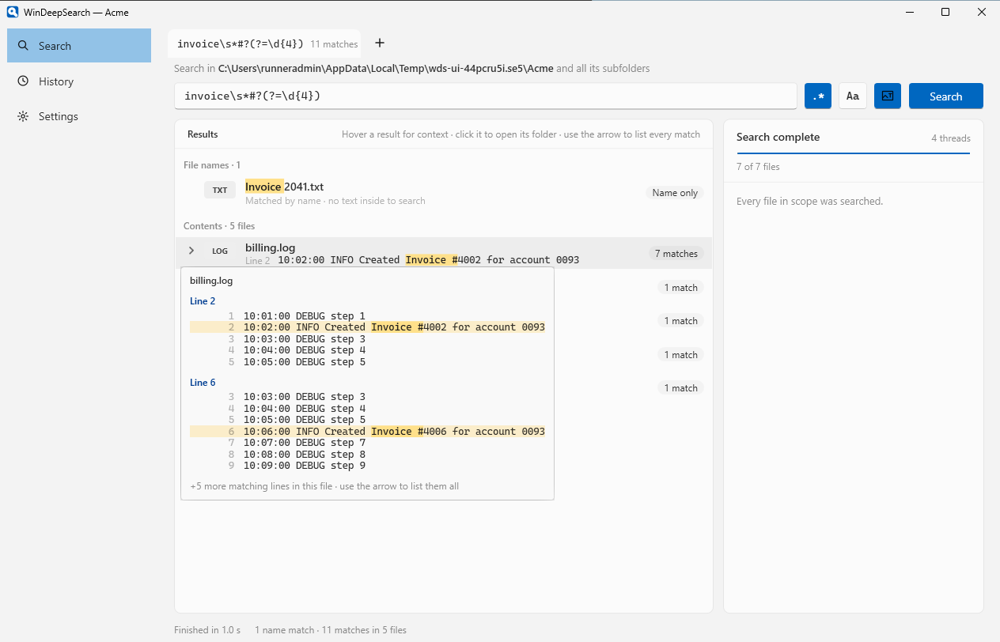
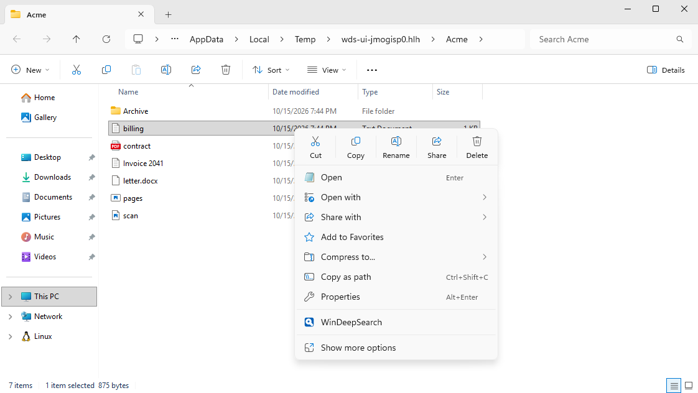
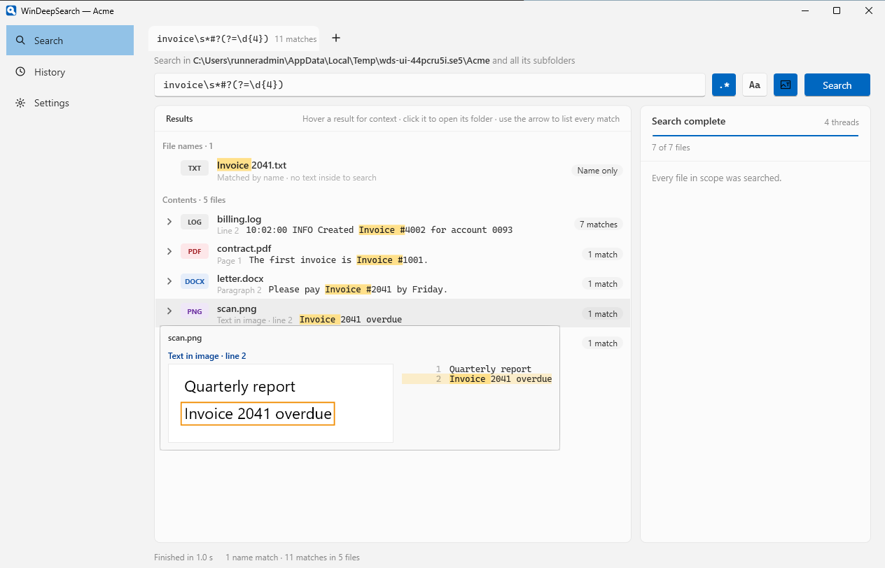
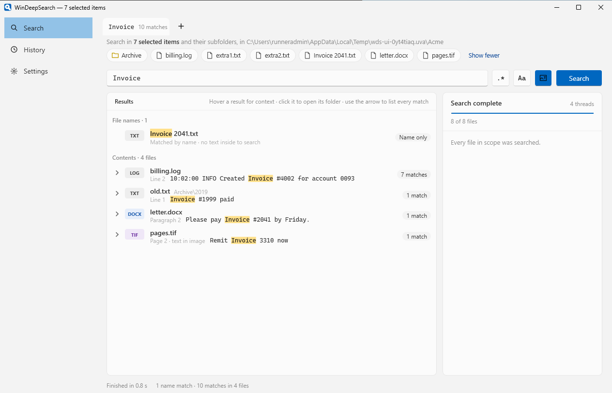
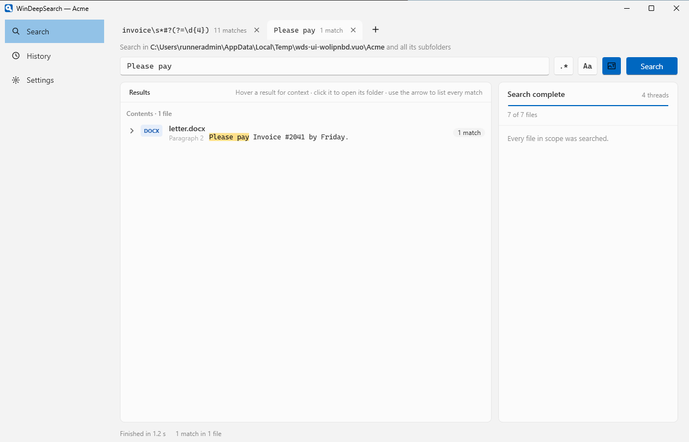
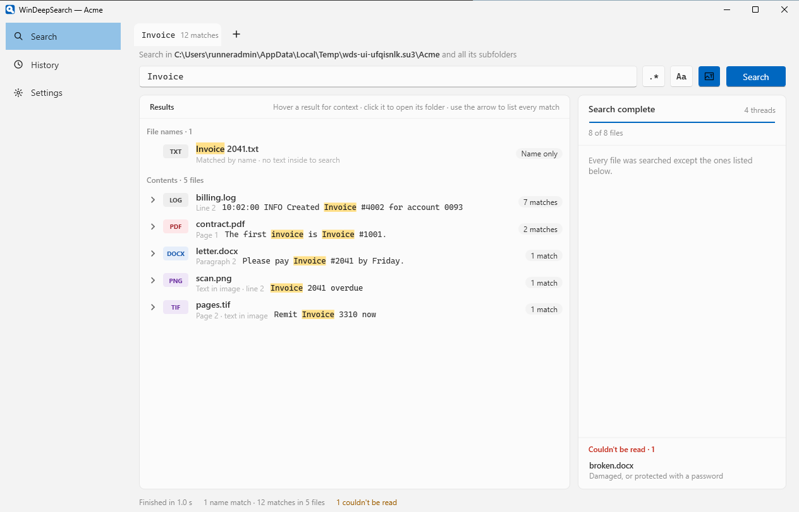
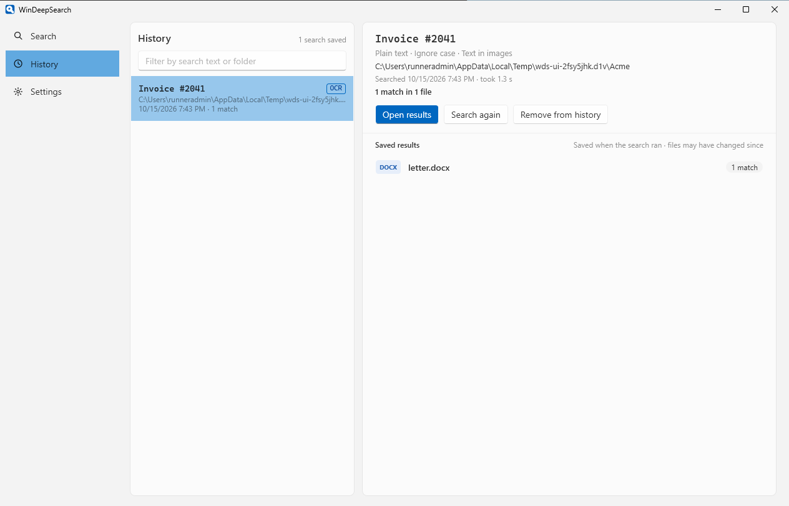
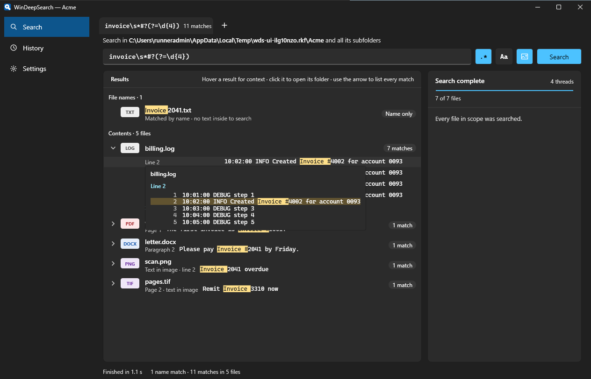

# WinDeepSearch

[](https://github.com/lben/WinDeepSearch/releases/latest)
[](LICENSE)

Right-click a folder, type what you're looking for, and see every line in every file that mentions it. Word documents,
spreadsheets, PDFs, logs, source code, even the text inside screenshots and scanned pages.

Windows search finds files by name and, if you're lucky, by whatever its index happened to pick up. WinDeepSearch reads
the files themselves, right now, with no index to build or wait for.



## Why you might want it

**It lives where you already are.** There's a WinDeepSearch entry in the right-click menu of every file, folder and
folder background in File Explorer, including the new Windows 11 menu, not just under "Show more options".



**It reads the formats your work is actually in:**

- Plain text in any encoding: logs, CSV, JSON, code, config files. Detected by content, so odd extensions are fine.
- Word, Excel and PowerPoint, including the old `.doc`, `.xls` and `.ppt`, plus LibreOffice files.
- PDFs, including scanned ones.
- Text inside pictures: screenshots, photos of whiteboards, and pictures pasted into documents and slides, read with
  [PaddleOCR](https://github.com/PaddlePaddle/PaddleOCR). Hover a match and you see the picture, with the line
  outlined.



**Real regular expressions.** Press `.*` and you get the full .NET regex engine: lookahead, lookbehind, the lot. `Aa`
makes it case-sensitive. Nothing runs until you press Enter, so it isn't chewing through your disk while you're still
typing a pattern.

**Results you can read at a glance.** Files whose names match come first, then files ranked by how many times they
match. Each row shows the first matching line. Hover for the lines around it, open the arrow to list every match, and
click to jump to the file in File Explorer.

**Search exactly what you picked.** Select a few files and folders, right-click one, and the search covers just those,
with everything inside the folders.



**Tabs.** Started a slow search across a big folder? Press **+** (or Ctrl+T) and try another query on the same files
while the first one keeps going.



**Nothing hides from you.** A panel on the right shows the files that take a while, each with a progress bar and a
**Skip** button, so one huge log doesn't hold everything up. Files that were skipped and files that couldn't be read
(locked by another program, password-protected, damaged) are listed with the reason, so you know exactly what the
results don't cover.



**It's quick.** Every core gets a share of the work. In a benchmark with 20,000 small text files the engine finishes in
about half a second. Text read from pictures is remembered, so a second search over the same scans is fast too.

**It keeps your history.** Every search is saved with its results. Open them again later, or run the search again in a
new tab. Settings let you skip folders such as `node_modules` or `.git`, choose how many lines of context to show, and
decide how many searches to keep.



It follows your Windows light or dark setting:



**It's private.** WinDeepSearch never sends anything anywhere. Your searches, their results and the text read from
pictures stay on your PC, in `%LOCALAPPDATA%\WinDeepSearch`.

## Install

1. Download `WinDeepSearch-Setup.exe` from the [latest release](https://github.com/lben/WinDeepSearch/releases/latest).
2. Run it. It installs for your account only, in `%LOCALAPPDATA%\Programs\WinDeepSearch`.
3. Right-click any folder and pick **WinDeepSearch**.

Two things you'll see:

- **A SmartScreen warning.** The installer isn't code-signed yet. Click **More info**, then **Run anyway**.
- **One administrator prompt** (on a standard account, it asks for an administrator's password). The Windows 11 menu only
  shows entries from signed packages, so the installer trusts the package's certificate once. Updates are signed with
  the same certificate and don't ask again; updating from 0.1.0 asks one more time. Say no and the entry still appears
  under **Show more options**. You can add it to the Windows 11 menu later by running
  `%LOCALAPPDATA%\Programs\WinDeepSearch\WinDeepSearch.exe --register` from **Win+R**.

To uninstall, go to **Settings › Apps**. That removes the menu entries too.

## Using it

- **Right-click a folder**, or the empty space inside one, to search that folder and everything below it.
- **Right-click a file** to search the folder it's in. Tick **Just this selected file** to search only that file.
- **Select several items** and right-click one of them to search just those.
- **Open WinDeepSearch from the Start menu** to search any folder you type or browse to (the whole `C:\` drive by
  default). Pasting a path copied with File Explorer's "Copy as path" works.
- On a drive in **This PC**, the entry is under **Show more options**.

## Limits worth knowing

- Up to 5,000 matching lines are kept per file and 200,000 per search. Past that the match count is still exact, and the
  list tells you that later lines weren't kept.
- Large text files are read in 4-million-character chunks. A single match longer than about 64,000 characters that
  crosses a chunk boundary is missed.
- Excel binary workbooks (`.xlsb`), Outlook messages, Visio, Publisher and OneNote files need the readers that
  Microsoft Office installs. Without Office they show up under "Couldn't be read".
- OneDrive files that exist only online aren't downloaded; they're listed as skipped.
- Archives (`.zip` and the like) aren't opened.
- If File Explorer already has the result's folder open, Windows selects the file in that window instead of opening a
  new one.
- Without the Windows 11 entry (if you declined the certificate prompt), Windows offers the classic entry for up to 100
  selected items.

## Building from source

You need Windows 11 with the .NET 10 SDK, the Visual Studio 2022 C++ tools (or Build Tools), CMake and Inno Setup 6:

```powershell
dotnet test --project tests/WinDeepSearch.Core.Tests
cmake -S src/WinDeepSearch.ShellExt -B build/shellext -A x64; cmake --build build/shellext --config Release
dotnet publish src/WinDeepSearch -c Release -o artifacts/app
Copy-Item build/shellext/Release/WinDeepSearch.ShellExt.dll artifacts/app/
./packaging/build-package.ps1 -AppDir artifacts/app
iscc packaging/WinDeepSearch.iss
```

The engine and its tests also build and run on macOS (`dotnet test --project tests/WinDeepSearch.Core.Tests`); the
Windows-only tests are skipped there.

Every push runs [the build workflow](.github/workflows/build.yml) on a Windows machine. It builds the installer,
installs it, drives the real app and File Explorer's menus through UI tests (the screenshots above come from those
runs), then uninstalls. Pushing a tag such as `v0.4.0` publishes that version as a release once everything passes.

### Where things are

- `src/WinDeepSearch.Core`: the search engine. File walking, text detection, the document readers, OCR and history.
- `src/WinDeepSearch`: the Windows app (WPF).
- `src/WinDeepSearch.ShellExt`: the Windows 11 menu command, a small C++ COM DLL.
- `packaging`: the menu package manifest, the signing script and the installer script.
- `tests`: engine tests and UI tests.

Bug reports and pull requests are welcome. If a file isn't found that should be, attaching a copy (or one like it) makes
it much easier to fix.

## License

MIT, see [LICENSE](LICENSE). The installer also bundles third-party components under their own licenses, listed in
[THIRD-PARTY-NOTICES.md](THIRD-PARTY-NOTICES.md).
